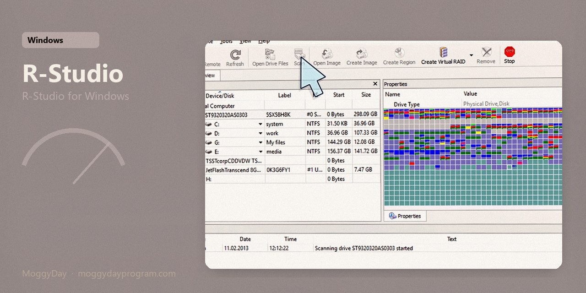
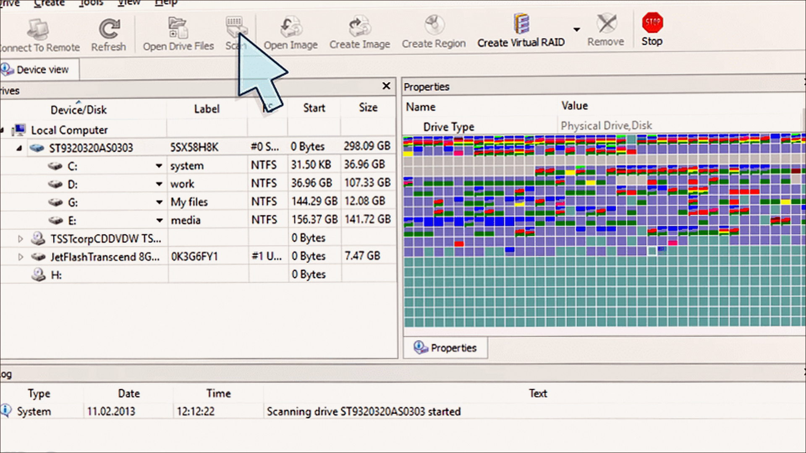
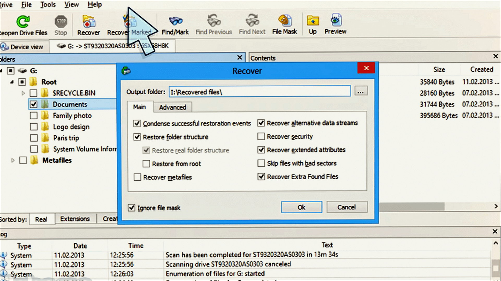
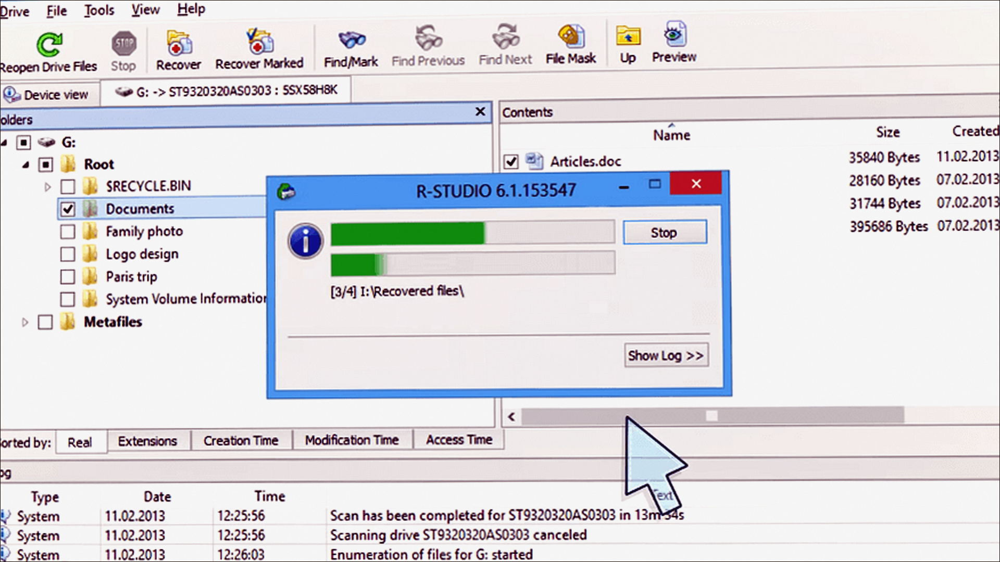

# R-Studio 9.5

R-Studio for Windows. R-Studio on Windows 10/11 x64. 109 MB. Requirements, screenshots, MoggyDay Launcher.

[Pages](https://thresholdtivibrate.github.io/r-studio-windows/) · [RU](https://moggydayprogram.com/programs/r-studio) · [EN](https://moggydayprogram.com/en/programs/r-studio)

  

  
  
  

1. Open the RU or EN card on moggydayprogram.com
2. Press **Download** on that card. The file is only on moggydayprogram.com — not in this repo.

Category: [System catalog](https://moggydayprogram.com/categories/system)

- [Recuva](https://moggydayprogram.com/programs/recuva)
- [MiniTool Power Data Recovery](https://moggydayprogram.com/programs/minitool-power-data-recovery)

No installer in this git repo.
